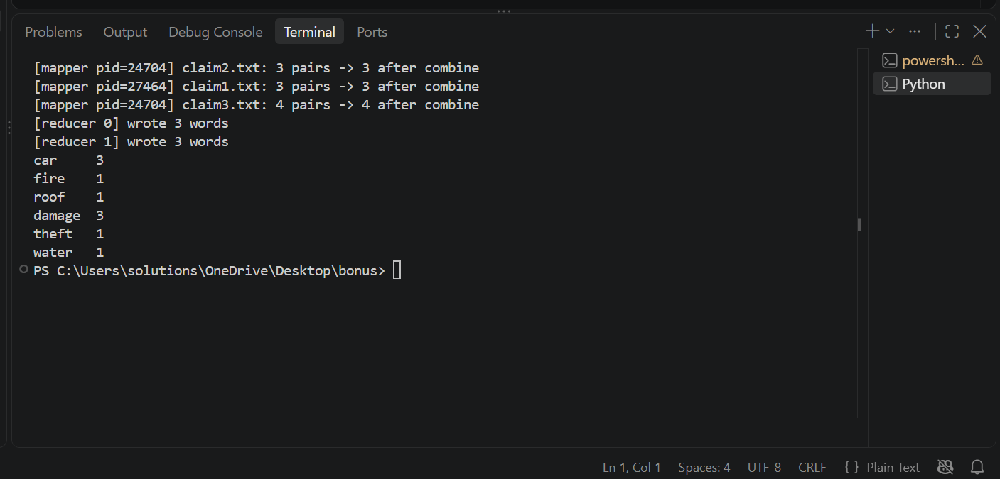

# MapReduce-like Word Count Engine (Python, no Hadoop/Spark)

## Pipeline
1. **Input** – every file in `input/` is one split.
2. **Map** – for each split, emit `(word, 1)`.
3. **Parallel mappers** – `multiprocessing.Pool`, one process per split.
4. **Combine + Partition** – local subtotals per mapper, then each word goes to one of 2 reducers (`sum(ord(c)) % 2`).
5. **Shuffle & Sort -> Reduce** – each reducer collects its pairs from all mappers, sorts by key, groups, sums, and writes `output/part-r-0000N`.

All grouping/counting is hand-written (no `Counter`, no `groupby`).

## How to run
    python mapreduce.py input output

## Sample input (`input/`)
- claim1.txt: `Car damage in a fire.`
- claim2.txt: `Car damage and theft!`
- claim3.txt: `Car damage to the roof, plus water.`

## Sample output
`output/part-r-00000`: car 3, fire 1, roof 1
`output/part-r-00001`: damage 3, theft 1, water 1

## Screenshot

